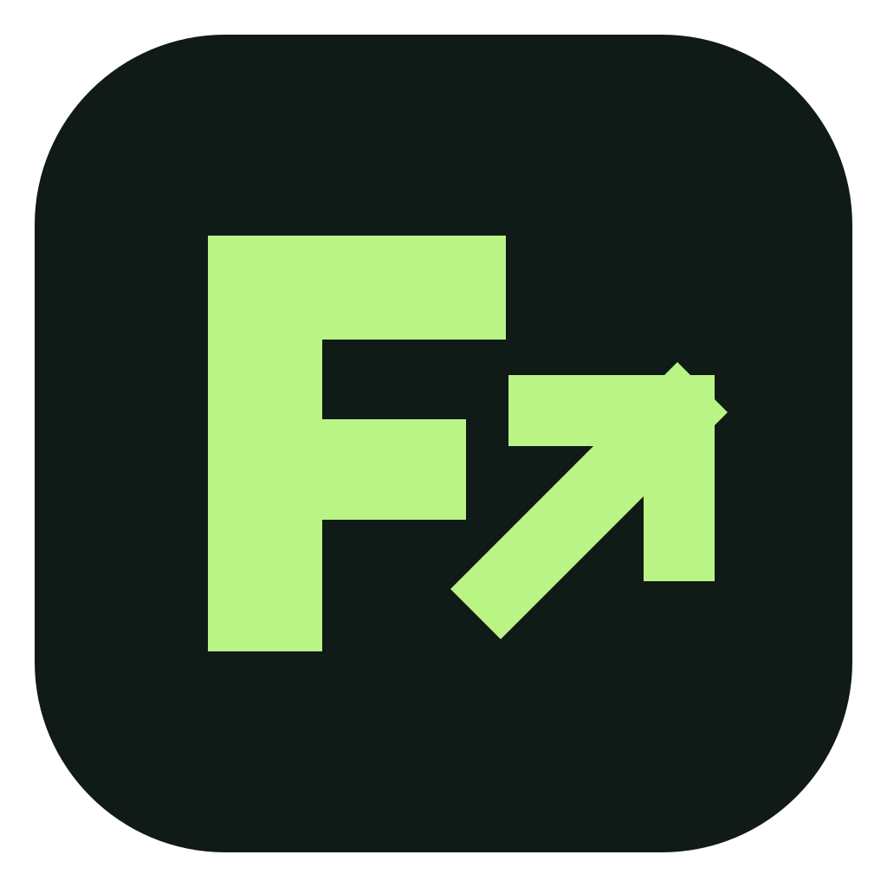
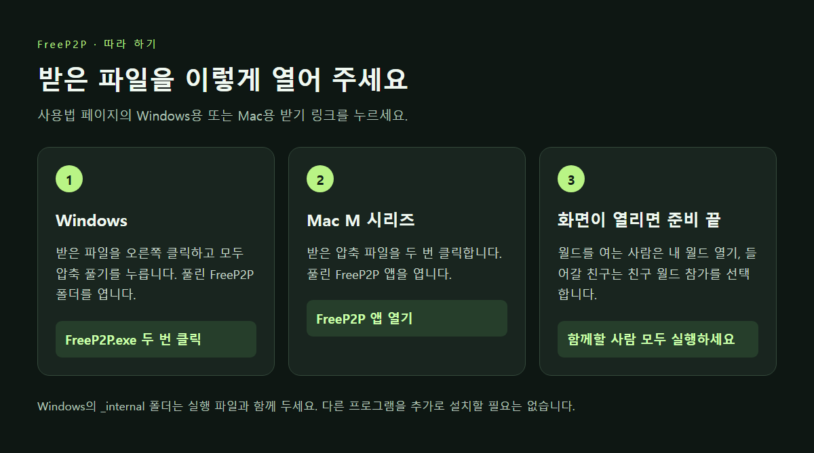
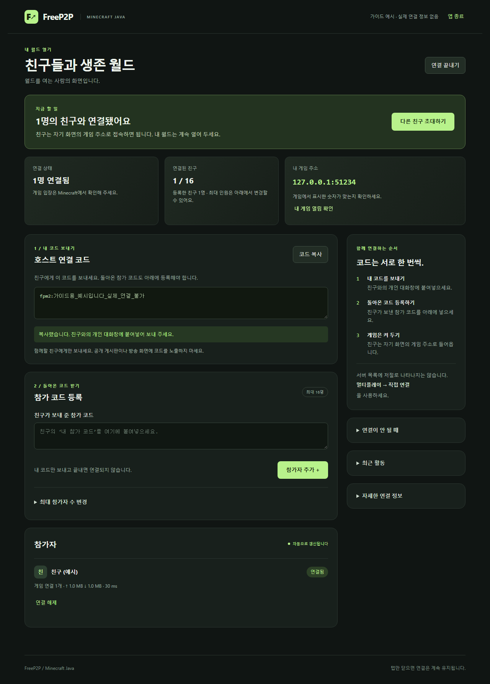

<p align="center"></p>

# FreeP2P

친구를 내 Minecraft 월드로 초대하는 프로그램입니다.
함께할 사람 모두 실행한 뒤, 월드를 여는 사람과 참가자가 코드를 서로 주고받습니다. 조작은 브라우저에서 합니다.

**PC용 Minecraft Java Edition이 필요합니다.** 휴대폰·콘솔용 Minecraft나 Bedrock Edition에서는 사용할 수 없습니다.
Python 등 별도 프로그램을 설치할 필요는 없습니다.

**0.4.0의 공유 코드는 호스트 103자, 참가자 60자입니다.** 함께할 사람 모두 0.4.0 이상으로 업데이트한 뒤 새 코드를 주고받으세요.

## 다운로드

| 사용하는 컴퓨터 | 받을 파일 | 받은 뒤 할 일 |
| --- | --- | --- |
| Windows PC (x64) | [Windows용 받기](https://github.com/POBSIZ/FreeP2P/releases/download/v0.4.0/FreeP2P-0.4.0-windows-x64.zip) | 모두 압축 풀기 → FreeP2P 폴더 → FreeP2P.exe 실행 |
| Mac M 시리즈 | [Mac용 받기](https://github.com/POBSIZ/FreeP2P/releases/download/v0.4.0/FreeP2P-0.4.0-darwin-arm64.zip) | 압축 파일 두 번 클릭 → FreeP2P 앱 실행 |

Windows는 실행 파일 옆 `_internal` 폴더도 필요하므로 실행 파일만 따로 옮기지 마세요. Intel Mac용과 Windows ARM 전용 버전은 아직 없습니다.



**처음이라면 [화면을 보며 따라 하기](docs/USER_GUIDE.md)부터 읽어 주세요.**
[실행 경고가 나올 때](docs/SECURITY_WARNINGS.md) · [연결이 안 될 때](docs/TROUBLESHOOTING.md) · [다른 다운로드 파일](https://github.com/POBSIZ/FreeP2P/releases)

## 어떻게 같이 하나요?

1. 월드를 여는 사람이 게임에서 **Esc → LAN 서버 열기 → LAN 월드 시작**을 누릅니다.
2. FreeP2P에서 **내 월드 열기**를 선택합니다. **게임에서 표시된 LAN 포트**에 그 숫자를 입력하고 **호스트 시작**을 누릅니다.
3. **코드 복사**를 눌러 친구에게 보냅니다.
4. 친구는 **친구 월드 참가**에서 받은 코드를 넣고 **참가 준비**를 누릅니다. 다음 화면의 **내 참가 코드**도 월드를 연 사람에게 보냅니다.
5. 월드를 연 사람은 **참가 코드 등록**에 돌아온 코드를 붙여넣고 **참가자 추가 +**를 누릅니다.
6. 친구는 **연결됨**을 확인한 뒤, 화면의 게임 접속 주소를 복사해 Minecraft **직접 연결**에 붙여넣습니다.



*이름과 코드는 설명용 예시입니다. 위 화면의 코드는 연결에 사용할 수 없습니다.*

## 사용 전에 알아 두세요

- 코드는 함께할 친구에게만 보내세요. 공개 게시판이나 방송 화면에 올리면 안 됩니다.
- 월드를 연 사람이 게임을 닫거나 컴퓨터를 절전 상태로 두면 친구들의 연결이 끊깁니다.
- 브라우저 탭만 닫아도 프로그램은 계속 켜져 있습니다. 끝낼 때는 **앱 종료**를 누르세요.
- 인터넷이나 공유기 환경에 따라 연결이 안 될 수 있습니다.
- 처음 실행할 때 Windows나 Mac이 경고를 띄울 수 있습니다. [경고창 안내](docs/SECURITY_WARNINGS.md)를 확인하세요.

아직 시험 배포 중입니다. 프로그램 사이의 데이터 전송은 확인했지만 **실제 Minecraft 월드 입장은 아직 검증하지 않았습니다.**
Mojang/Microsoft와 관계없는 비공식 도구입니다.

## 개발·검증

[빌드 방법](BUILDING.md) · [검증 범위](TEST_RESULTS.md) · [보안 정책](SECURITY.md)

프로젝트 최상위 폴더에서 실행하세요.

**Windows PowerShell**

```powershell
python -m venv .venv
.venv\Scripts\python.exe -m pip install -r requirements.txt
.venv\Scripts\python.exe minecraft_web.py
```

**Mac 터미널**

```bash
python3 -m venv .venv
.venv/bin/python -m pip install -r requirements.txt
.venv/bin/python minecraft_web.py
```

웹 프로그램을 종료한 뒤 같은 가상환경의 Python에 `-m unittest discover -v`를 붙여 자동 테스트를 실행할 수 있습니다.
소스 코드를 직접 실행하려면 Python 3.10 이상이 필요합니다. 위에서 받은 Windows·Mac용 앱을 사용한다면 이 과정은 필요 없습니다.
`start-web.cmd` / `bash start-web.sh`도 개발용으로 사용할 수 있습니다.
`freep2p.py`는 초기 UDP 채팅 CLI이며 Minecraft 배포 앱과 다릅니다. 그 채팅에는 메시지 암호화가 없습니다.
가이드 이미지는 `tools/capture_guide.py`로 가상 데이터만 사용해 생성합니다.

## 라이선스

프로젝트 코드와 자체 제작 아이콘·안내 그림에는 [MIT 라이선스](LICENSE)가 적용됩니다.
앱에 포함된 Python과 외부 라이브러리는 각각의 라이선스를 따릅니다. 해당 안내는 배포본의 `notices`에 있습니다.
