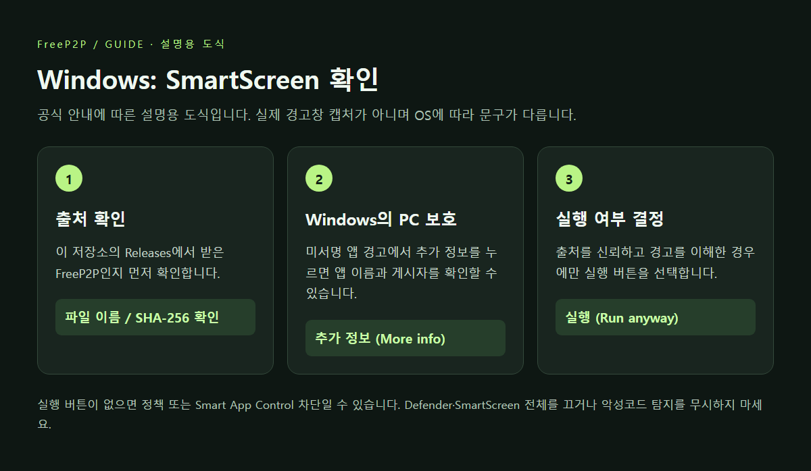
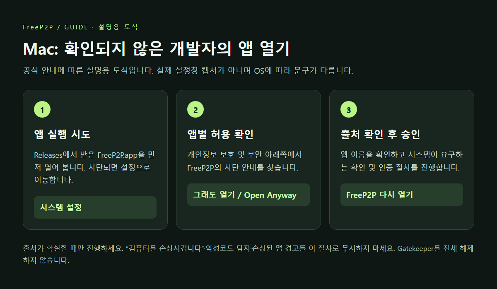

# 실행하려는데 경고가 뜨나요?

[사용법으로 돌아가기](USER_GUIDE.md) · [파일 받기](https://github.com/POBSIZ/FreeP2P/releases/tag/v0.4.0)

FreeP2P의 Windows 배포본에는 개발자를 확인하는 코드 서명이 없습니다.
Mac 배포본도 Apple의 Developer ID 서명과 공증을 받지 않아 실행 시 경고가 나올 수 있습니다.
**먼저 [FreeP2P 다운로드 페이지](https://github.com/POBSIZ/FreeP2P/releases/tag/v0.4.0)에서 직접 받은 파일인지 확인하세요.**
출처를 모르는 파일이라면 실행하지 말고 이 페이지에서 다시 받으세요.

아래 그림은 순서를 설명하기 위해 만든 안내 그림입니다. 실제 경고창과 생김새나 문구가 조금 다를 수 있습니다.

## Windows에서 ‘Windows의 PC 보호’가 나올 때

1. 경고창의 **추가 정보**를 누릅니다.
2. 앱 이름이 `FreeP2P.exe`인지 확인합니다. 게시자는 ‘알 수 없는 게시자’로 표시될 수 있습니다.
3. 다운로드 출처를 확인하고 실행하기로 했다면 **실행**을 누릅니다.



**‘실행’ 버튼이 없나요?** 보안 설정이나 회사·학교의 정책에 따라 실행이 허용되지 않을 수 있습니다.
관리자가 있는 컴퓨터라면 문의하세요. FreeP2P를 실행하기 위해 보안 기능을 통째로 끄지는 마세요.

**‘바이러스’나 ‘위협이 발견됨’이라고 나오나요?** 위 경고와 다른 경우입니다.
차단된 파일을 복원하거나 실행을 강행하지 마세요.
[문제 신고](https://github.com/POBSIZ/FreeP2P/issues/new?template=bug_report.md)에 경고 문구와 FreeP2P 버전을 알려 주세요.
화면을 첨부한다면 파일 경로에 포함된 개인 이름 등은 가려 주세요.

## Mac에서 개발자나 악성 소프트웨어 여부를 확인할 수 없다고 나올 때

1. `FreeP2P` 앱을 한 번 열어 보고 경고를 확인합니다.
2. 화면 왼쪽 위 **Apple → 시스템 설정 → 개인정보 보호 및 보안**으로 들어갑니다.
3. 아래로 내려 FreeP2P가 차단되었다는 안내를 찾습니다.
4. 다운로드 출처를 확인하고 실행하기로 했다면 **그래도 열기**를 누릅니다.
5. 다시 나타난 경고에서 앱 이름을 확인하고 **열기**를 누릅니다. 암호나 지문 확인을 요청하면 진행합니다.



회사·학교에서 관리하는 Mac은 이 설정을 바꾸지 못할 수 있습니다. 허용 버튼이 보이지 않으면 관리자에게 문의하세요.
**‘컴퓨터를 손상시킵니다’ 또는 ‘앱이 손상되었습니다’**라고 나오면 위 단계를 그대로 따라 하지 마세요.
실행을 중단하고 다운로드 출처와 파일을 확인하세요. 공식 다운로드 페이지에서 다시 받아도 같은 경고가 나오면
[문제 신고](https://github.com/POBSIZ/FreeP2P/issues/new?template=bug_report.md)에 정확한 경고 문구를 알려 주세요.

## 네트워크 사용을 허용할지 물어볼 때

이 창은 실행 여부가 아니라 FreeP2P의 네트워크 통신을 허용할지 묻습니다.
프로그램 이름과 위치가 방금 실행한 FreeP2P인지 확인한 뒤, 사용하려는 네트워크에서 앱의 통신을 허용하세요.
회사·학교 컴퓨터에서는 관리자에게 확인하세요. 방화벽 전체를 끌 필요는 없습니다.

<details>
<summary>다운로드한 파일을 직접 확인하려면 (선택)</summary>

아래 명령은 파일 확인용이며 앱 실행에 필요한 단계는 아닙니다.
다운로드 페이지에서 압축 파일과 이름이 같은 `.sha256` 파일을 함께 받으세요.

압축 파일이 있는 폴더에서 Windows PowerShell은 다음 명령을 사용합니다.

```powershell
Get-FileHash -Algorithm SHA256 .\FreeP2P-0.4.0-windows-x64.zip
```

Mac 터미널에서는 다음 명령을 사용합니다.

```bash
shasum -a 256 FreeP2P-0.4.0-darwin-arm64.zip
```

명령 결과의 긴 영문·숫자 문자열을 `.sha256` 파일에 적힌 문자열과 비교하세요. 대소문자는 구분하지 않습니다.
일치하지 않으면 압축 파일을 실행하지 말고 다시 받으세요.
일치하더라도 프로그램의 안전성이나 제작자 신원이 증명되는 것은 아닙니다.

</details>

경고의 의미와 실행 허용 절차는 [Microsoft의 SmartScreen 안내](https://learn.microsoft.com/en-us/windows/apps/package-and-deploy/smartscreen-reputation)와
[Apple의 Mac 앱 실행 안내](https://support.apple.com/ko-kr/102445)를 기준으로 작성했습니다. 2026년 10월 13일 확인.
