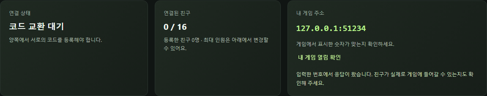
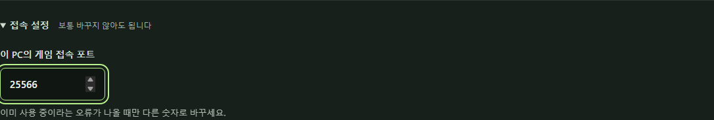

# 잘 안 될 때

[사용법](USER_GUIDE.md) · [실행 경고 안내](SECURITY_WARNINGS.md)

화면에 나온 문구나 문제가 생긴 단계에 해당하는 항목을 확인하세요.

## 프로그램이 안 열려요

Windows에서는 받은 압축 파일을 마우스 오른쪽 버튼으로 눌러 **모두 압축 풀기**를 선택하세요.
압축을 푼 폴더의 `FreeP2P.exe`를 실행합니다. `FreeP2P.exe`와 `_internal` 폴더는 같은 폴더 안에 있어야 하므로,
실행 파일만 따로 옮겼다면 원래 폴더로 되돌려 놓으세요.

Mac 배포본은 M 시리즈 Mac 전용입니다. **Apple → 이 Mac에 관하여**에 Intel이라고 나오면 이 배포본을 사용할 수 없습니다.
실행을 막는 경고가 보이면 [경고창 안내](SECURITY_WARNINGS.md)를 확인하세요.

## 화면을 닫았는데 다시 어디서 여나요?

`FreeP2P.exe` 또는 Mac의 `FreeP2P` 앱을 다시 여세요. 프로그램이 계속 켜져 있다면 기존 연결의 화면이 열립니다.
**‘FreeP2P 실행 파일을 다시 열어 주세요’**라는 안내가 나올 때도 같은 방법을 쓰세요.
저장해 둔 브라우저 주소는 앱을 종료한 뒤 다시 실행하면 사용할 수 없으므로, 실행 파일로 화면을 여세요.

## 코드가 안 나오고 ‘코드 준비 실패’라고 떠요

인터넷이 연결되어 있는지 확인한 뒤 **연결 끝내기**를 누르고 다시 시작해 보세요.
FreeP2P는 연결 코드를 준비할 때 인터넷에서 접속할 주소를 확인합니다. 인터넷이 끊긴 상태에서 시작했다면 자동 재시도만으로 복구되지 않을 수 있습니다.
회사·학교·공용 인터넷에서는 프로그램의 통신이 막혀 있을 수 있습니다.
가능하면 집 인터넷 등 다른 환경에서 시도해 보세요. 보안 프로그램을 무작정 끄지는 마세요.

## 코드까지 넣었는데 ‘연결됨’이 안 나와요

월드를 연 사람과 들어갈 친구가 함께 확인하세요.

1. 두 사람 모두 FreeP2P가 켜져 있나요?
2. 월드를 연 사람이 **호스트 연결 코드**를 친구에게 보냈나요?
3. 들어갈 친구도 **내 참가 코드**를 돌려보냈나요?
4. 월드를 연 사람이 돌아온 코드를 넣고 **참가자 추가 +**까지 눌렀나요?

위 순서를 마쳤다면 참가자 목록의 **다시 연결** 버튼이 보일 때 눌러 보세요.
그래도 안 되면 두 사람 모두 **연결 끝내기**를 누르고 다시 시작하세요.
새로 표시된 코드를 주고받고 등록해야 합니다. 이전에 복사해 둔 코드는 사용하지 마세요.

인터넷이나 공유기 환경에 따라 FreeP2P로 연결할 수 없는 경우가 있습니다.
같은 집 인터넷을 써도 연결이 보장되지는 않습니다. 위 순서로 해도 안 된다면 다른 인터넷 환경에서 확인해 보세요.

## 받은 코드를 읽을 수 없다고 나와요

`fpm2:`로 시작하는 짧은 코드는 FreeP2P 0.3.0 이상에서 사용할 수 있습니다.
함께할 사람 모두 [새 버전](https://github.com/POBSIZ/FreeP2P/releases/tag/v0.3.0)을 받아 실행한 뒤 코드를 새로 주고받으세요.
코드를 직접 고치거나 `fpm2:` 부분을 지우지 말고 **코드 복사**로 전체를 보내 주세요.
새 버전은 예전의 `fpm1:` 코드도 읽을 수 있지만, 예전 앱은 새 코드를 읽지 못합니다.

## FreeP2P는 ‘연결됨’인데 게임에 못 들어가요

**월드를 연 사람**이 확인할 것:

- Minecraft 월드가 아직 열려 있나요?
- **LAN 서버 열기**를 했나요?
- 게임이 알려 준 숫자와 FreeP2P에 입력한 **LAN 포트**가 같은가요?

FreeP2P의 **내 게임 열림 확인**을 누르면 입력한 LAN 포트에 연결할 수 있는지 확인합니다. 결과는 버튼 아래에 나옵니다.
응답이 없다고 나오면 게임에서 LAN 서버를 열었는지, 표시된 숫자를 제대로 적었는지 먼저 확인하세요.

월드를 다시 열었다면 LAN 포트가 바뀌었을 수 있습니다.
게임에 표시된 숫자를 확인하고, 달라졌다면 FreeP2P도 **연결 끝내기** 후 새 숫자로 시작하세요. 친구와 코드도 다시 교환해야 합니다.

**들어갈 친구**가 확인할 것:

- FreeP2P의 **게임 접속 주소 복사**를 눌렀나요?
- Minecraft **멀티플레이 → 직접 연결**의 서버 주소 칸에 붙여넣었나요?
- 메신저에서 받은 연결 코드나 브라우저 주소를 넣지는 않았나요?

두 사람이 사용하는 Minecraft 버전과 필요한 모드도 맞아야 합니다. 게임에서 로그인 관련 오류가 나오면 그 안내를 확인하세요.
**내 게임 열림 확인**은 Minecraft의 정상 동작이나 친구의 실제 입장까지 검사하지 않습니다.

## ‘포트를 열 수 없습니다’라고 떠요

다른 프로그램이 같은 포트 번호를 사용 중일 수 있습니다.
**친구 월드 참가**에서 준비하다가 이 오류가 났다면 다음과 같이 바꿔 보세요.

1. **접속 설정**을 펼칩니다.
2. **이 PC의 게임 접속 포트**를 `25565`에서 `25566`으로 바꿉니다.
3. **참가 준비 →**를 다시 누릅니다.

연결 후에는 **게임 접속 주소 복사**로 새 주소를 복사해 Minecraft에 입력하세요.

## 최대 참가자 수를 줄일 수 없어요

최대 참가자 수는 이미 등록한 친구 수보다 작게 설정할 수 없습니다.
참가자 목록에서 더 이상 함께하지 않을 친구의 **연결 해제**를 누르고 확인하세요. 해당 친구가 접속 중이면 게임 연결도 끊깁니다.
그다음 **참가 코드 등록** 영역의 **최대 참가자 수 변경**을 펼쳐 숫자를 줄이고 **적용**을 누르세요.

## ‘프로그램의 응답을 기다리고 있어요’라고 떠요

브라우저가 FreeP2P의 현재 상태를 확인하지 못했습니다. 화면에는 마지막으로 확인한 내용이 남아 있어 실제 연결 상태와 다를 수 있습니다.
FreeP2P가 켜져 있는지 확인하고 **다시 확인**을 누르세요.
앱을 종료했다면 실행 파일을 다시 열어 주세요. 연결을 새로 시작했다면 친구와 코드도 다시 주고받아야 합니다.

## 여전히 안 되면 알려 주세요

[문제 신고하기](https://github.com/POBSIZ/FreeP2P/issues/new?template=bug_report.md)에서 다음 내용을 적어 주세요.

- Windows인지 Mac인지, 운영체제와 FreeP2P 버전
- 월드를 여는 쪽인지 들어가는 쪽인지
- 어느 버튼을 누른 뒤 문제가 생겼는지
- 화면이나 게임에 나온 오류 문구

신고 글은 누구나 볼 수 있습니다. 화면을 첨부한다면 **연결 코드, 브라우저 주소, IP 주소, 본인과 친구의 이름을 가려 주세요.**
로그 파일에도 접속 정보가 들어 있을 수 있으므로 통째로 올리지 마세요.

진단 파일 위치가 필요한 경우

- Windows: `%LOCALAPPDATA%\FreeP2P\app.log`
- Mac: `~/Library/Application Support/FreeP2P/app.log`

오류 부분만 골라서 확인하고, 신고에 붙여넣기 전에도 민감 정보가 없는지 살펴보세요.
같은 폴더의 `instance.json`과 `instance.lock`, 로그 전체는 공개하지 마세요.

